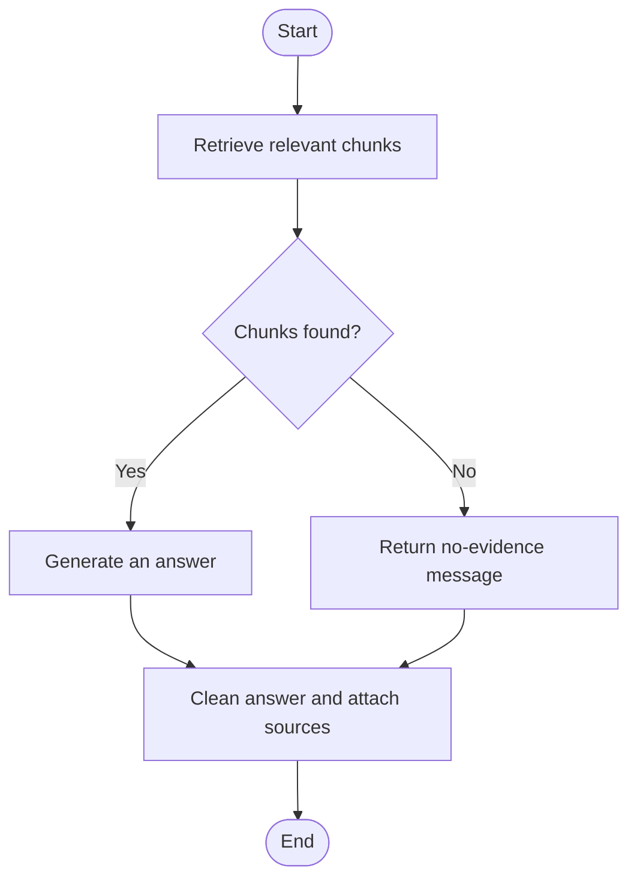

# Local RAG Agent for University Rules

A local Retrieval-Augmented Generation (RAG) application that answers questions about university academic regulations using **LangChain**, **LangGraph**, **Chroma**, and a local language model.

The application retrieves relevant excerpts from a Markdown document and combines them into a concise answer with source references.

> **Disclaimer:** The included Northbridge University regulations are fictional and intended for educational purposes.

## Features

- Load academic regulations from a Markdown file.
- Split documents by Markdown headings and then into overlapping chunks.
- Generate embeddings using a Sentence Transformers model.
- Store embeddings in a persistent Chroma vector database.
- Retrieve relevant chunks using similarity search with a score threshold.
- Generate answers using either:
  - Ollama, such as `qwen3.5:4b`.
  - Hugging Face Transformers, such as `Qwen/Qwen3.5-4B`.
  - LM Studio's OpenAI-compatible server, such as `qwen3.5-4b`.
- Orchestrate retrieval and generation with LangGraph.
- Expose retrieval through a LangChain tool with a Pydantic input schema.
- Attach document names and chunk IDs to answers.
- Return a fallback message when no supporting evidence is available.
- Export the workflow as a Mermaid diagram.

## Workflow



Each question uses a fresh graph state. The application does not retain conversation history.

## Project Structure

```text
.
├── rag_agent_local.py      # Application, indexing, and graph workflow
├── university_rules.md    # Source document containing academic regulations
├── requirements.txt       # Python dependencies
├── README.md              # Project documentation
├── chroma_db/             # Generated persistent vector database
└── rag_graph.mmd           # Generated Mermaid diagram
```

The `chroma_db/` directory is created during indexing. The `rag_graph.mmd` file is created by the graph command.

## Prerequisites

- Python 3.11 is recommended.
- Enough disk space for embedding and language model downloads.
- Internet access for the initial model downloads.
- For the Ollama backend: Ollama installed and running.
- For the Hugging Face backend: sufficient RAM or GPU memory to load the selected model.

After dependencies and models are available locally, inference and retrieval can run locally without a hosted LLM API.

## Installation

### 1. Clone the repository

Replace the example URL with your repository URL:

```bash
git clone https://github.com/YOUR_USERNAME/YOUR_REPOSITORY.git
cd YOUR_REPOSITORY
```

### 2. Create a virtual environment

```bash
python -m venv .venv
```

Activate it on Linux or macOS:

```bash
source .venv/bin/activate
```

Activate it on Windows PowerShell:

```powershell
.\.venv\Scripts\Activate.ps1
```

### 3. Install dependencies

```bash
python -m pip install --upgrade pip
python -m pip install -r requirements.txt
```

The requirements include dependencies for both supported LLM backends. Ollama itself must be installed separately if you choose that backend.

> For a GPU-specific PyTorch installation, follow the instructions at
> https://pytorch.org/get-started/locally/.

### 4. Add the source document

Place your regulations in:

```text
university_rules.md
```

Use Markdown headings to organize sections:

```markdown
# Northbridge University: Undergraduate Academic Regulations

## 1. Enrollment and Registration

Rule 1.1: Students must register during the official registration period.
Rule 1.2: Late registration is allowed during the first week and requires a fee of 50 USD.
```

The Markdown file is the knowledge source. Chroma is the vector database generated from that file.

## Quick Start

### Option A: Ollama

Install Ollama from https://ollama.com and download the model:

```bash
ollama pull qwen3.5:4b
```

Ensure Ollama is running. If necessary, start it in a separate terminal:

```bash
ollama serve
```

Configure the backend on Linux or macOS:

```bash
export LLM_BACKEND=ollama
export LLM_MODEL=qwen3.5:4b
```

On Windows PowerShell:

```powershell
$env:LLM_BACKEND = "ollama"
$env:LLM_MODEL = "qwen3.5:4b"
```

Build the index and start chatting:

```bash
python rag_agent_local.py index
python rag_agent_local.py chat
```

### Option B: Hugging Face

Hugging Face is the default backend:

```bash
python rag_agent_local.py index
python rag_agent_local.py chat
```

The default model is:

```text
Qwen/Qwen3.5-4B
```

It is downloaded on first use if it is not already cached. Qwen3.5 thinking mode is disabled for this backend so answers stay concise.

To select this backend explicitly on Linux or macOS:

```bash
export LLM_BACKEND=huggingface
export LLM_MODEL=Qwen/Qwen3.5-4B
```

## Commands

### Build or rebuild the index

```bash
python rag_agent_local.py index
```

This command:

1. Loads the Markdown document.
2. Splits it into sections and overlapping chunks.
3. Generates embeddings.
4. Replaces the existing configured Chroma collection.
5. Stores chunks with source metadata and chunk IDs.

> Indexing deletes and rebuilds the configured collection. Re-run it after changing the source document, embedding model, or chunking settings.

### Start interactive chat

```bash
python rag_agent_local.py chat
```

Example questions:

```text
What is the late registration deadline and fee?
How many credits can a student on probation take?
What happens if I miss a final exam because of an emergency?
When can I appeal my final grade?
Are AI tools allowed in assignments?
```

Type `exit` or `quit` to close the chat.

### Export the graph

```bash
python rag_agent_local.py graph
```

The command prints the Mermaid diagram and saves it to:

```text
rag_graph.mmd
```

Paste its contents into https://mermaid.live to view the diagram.

This command does not load embedding models, language models, or the vector database.

## Configuration

Configuration is read from environment variables.

| Variable | Default | Description |
|---|---|---|
| `DOC_PATH` | `university_rules.md` beside the script | Source Markdown document |
| `PERSIST_DIR` | `chroma_db` beside the script | Chroma persistence directory |
| `COLLECTION_NAME` | `university_rules` | Chroma collection name |
| `EMBED_MODEL` | `sentence-transformers/all-MiniLM-L6-v2` | Embedding model |
| `LLM_BACKEND` | `huggingface` | `huggingface`, `ollama`, or `lmstudio` |
| `LLM_MODEL` | Backend-dependent | Defaults to `Qwen/Qwen3.5-4B`, `qwen3.5:4b`, or `qwen3.5-4b` |
| `TOP_K` | `4` | Maximum number of retrieved chunks |
| `SCORE_THRESHOLD` | `0.25` | Minimum retrieval relevance score |
| `CHUNK_SIZE` | `600` | Target maximum chunk size in characters |
| `CHUNK_OVERLAP` | `100` | Chunk overlap in characters |
| `MAX_NEW_TOKENS` | `350` | Maximum generated answer tokens; Qwen3.5 uses at least 2048 |
| `QWEN35_MIN_NEW_TOKENS` | `2048` | Minimum token budget for Qwen3.5 thinking models |
| `SHOW_STEPS` | `0` | Set to `1` to print completed graph nodes |

Environment variables must be set in the terminal before running the application. The code does not automatically load a `.env` file.

Example on Linux or macOS:

```bash
export TOP_K=6
export SCORE_THRESHOLD=0.30
export SHOW_STEPS=1

python rag_agent_local.py chat
```

Example on Windows PowerShell:

```powershell
$env:TOP_K = "6"
$env:SCORE_THRESHOLD = "0.30"
$env:SHOW_STEPS = "1"

python rag_agent_local.py chat
```

## Answers and Sources

The prompt instructs the model to:

- Use only the retrieved context.
- Combine relevant information into one short paragraph.
- Mention supporting rule numbers.
- Avoid inventing policies, fees, numbers, or deadlines.

Source references are appended automatically in this format:

```text
Sources: [source=university_rules.md, chunk_id=N]
```

`N` is the chunk ID assigned during indexing.

The source list identifies retrieved chunks supplied to the model. It does not independently verify which chunks support each individual claim.

When retrieval returns no qualifying chunks, or the model reports insufficient evidence, the application returns:

```text
I do not have enough evidence in the provided documents.
```

## Implementation Overview

### Document processing

`TextLoader` loads the Markdown file.

`MarkdownHeaderTextSplitter` separates content using:

- `#` headings
- `##` headings
- `###` headings

`RecursiveCharacterTextSplitter` then divides long sections into smaller overlapping chunks.

Each chunk receives:

- `source`: the source filename.
- `chunk_id`: its numeric indexing identifier.
- Heading metadata when available.

### Retrieval

Embeddings are normalized and stored in a Chroma collection configured for cosine distance.

The retriever uses:

```python
search_type="similarity_score_threshold"
```

`TOP_K` and `SCORE_THRESHOLD` control how much context reaches the model.

### Generation

A LangChain chain combines:

```text
ChatPromptTemplate → Chat Model → StrOutputParser
```

All retrieved excerpts are formatted into one context input for answer generation.

### Orchestration

LangGraph connects four nodes:

- `retrieve`
- `generate`
- `refuse`
- `finalize`

The graph calls the retrieval tool directly. It is a fixed RAG workflow, not an autonomous tool-selection agent.

## Limitations

- Answers depend on retrieval quality and the selected language model.
- The similarity threshold is not a guarantee that a question is answerable.
- The prompt discourages unsupported claims but cannot completely prevent them.
- Follow-up questions are processed independently because there is no conversation memory.
- Large retrieval settings may exceed the model's context window.
- The Ollama backend currently uses a context setting of `4096`.
- The default embedding model is primarily suited to English documents.
- Source citations refer to chunks, not page numbers or verified claim-level references.
- The application currently indexes one Markdown file.

## Troubleshooting

### Empty vector database

Run indexing before starting chat:

```bash
python rag_agent_local.py index
```

Confirm that indexing and chat use the same `PERSIST_DIR`, `COLLECTION_NAME`, and `EMBED_MODEL`.

### Graph reports an unknown node

Check that the edge from `generate` uses the exact node name:

```python
workflow.add_edge("generate", "finalize")
```

Remove any hidden characters inside the string.

### Ollama connection error

Ensure Ollama is running and the model is installed:

```bash
ollama list
ollama pull qwen3.5:4b
```

### Relevant questions return no evidence

Try lowering `SCORE_THRESHOLD` or increasing `TOP_K`.

Also confirm that the source document contains the requested information and that the index is up to date.

### Answers omit important details

Try increasing `TOP_K` or `MAX_NEW_TOKENS`, while keeping the model's context limit in mind.

### Hugging Face runs slowly or runs out of memory

Use the Ollama backend, select a smaller model, or use suitable GPU hardware.

## Suggested Git Ignore Entries

```gitignore
.venv/
__pycache__/
*.pyc
chroma_db/
.env
```

Keep `university_rules.md` in the repository if you want others to reproduce the example.

## Interactive browser lab

The web interface makes the actual document splitting, Chroma retrieval, and LangGraph workflow inspectable. It includes streaming answers and node traces, a retrieval playground, and PCA/cosine visualizations of the indexed vectors. The regulations are fictional, and retrieved chunks are context, not claim-level verification. Conversation history is displayed in the browser but each question is independent.

### Setup

Use Python 3.11 or 3.12, Node.js 20+, and a running [LM Studio](https://lmstudio.ai/). Install dependencies in a virtual environment (for a CPU-only PyTorch installation, consult the PyTorch installation guide first):

```bash
python -m venv .venv
source .venv/bin/activate
pip install -r requirements.txt
npm install --prefix web
npm run build --prefix web
```

The first index build downloads `sentence-transformers/all-MiniLM-L6-v2` if it is not cached. Make sure LM Studio's local server is running at `http://127.0.0.1:1234` with `qwen3.5-4b` available and loaded. Qwen3.5 thinks by default; if LM Studio exposes a Reasoning / Thinking toggle for the model, turn it off for faster RAG answers. The app raises the generation budget for Qwen3.5 to at least 2048 tokens so thinking cannot consume the entire reply. A 4096-token context is enough for typical questions; increase it only if memory allows:

```bash
lms load qwen3.5-4b -c 4096 --parallel 1 --gpu off
python rag_agent_local.py web
```

Override the LM Studio model or URL if needed:

```bash
export LLM_MODEL=qwen3.5-4b
export LMSTUDIO_BASE_URL=http://127.0.0.1:1234/v1
```

Open http://127.0.0.1:8011. Click **Build index**; then try the example question about late registration. Select the retrieved chunks, open **Live workflow** to inspect node input/output, adjust retrieval controls in **Retrieval playground**, and load **Embedding explorer** to inspect the projection. PCA distorts distances; use the actual relevance scores to understand retrieval. A new index is built separately and becomes active only after it completes successfully. When the source or embedding model changes, rebuild it. Web and CLI indexing are separate; CLI commands continue to use the configured collection.

For frontend development, run `npm run dev --prefix web`; the Vite server proxies API calls to the FastAPI server on port 8011. The production build serves all browser assets locally.
